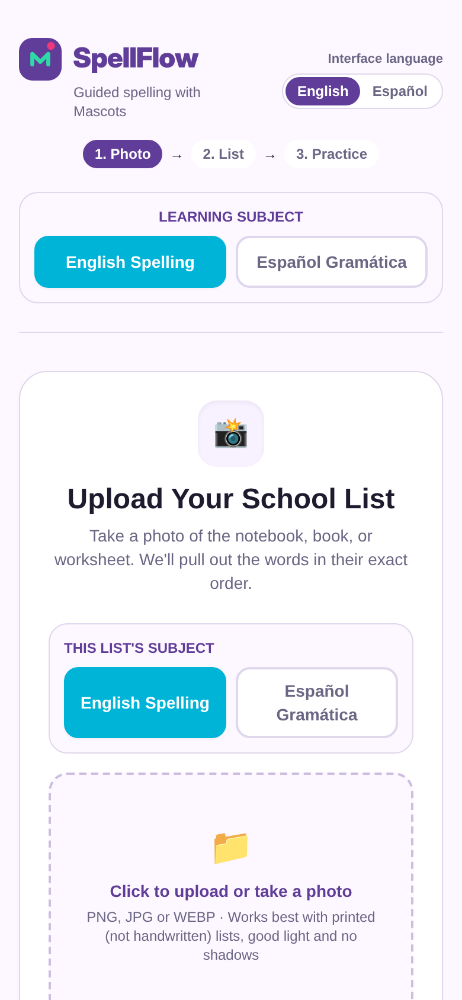
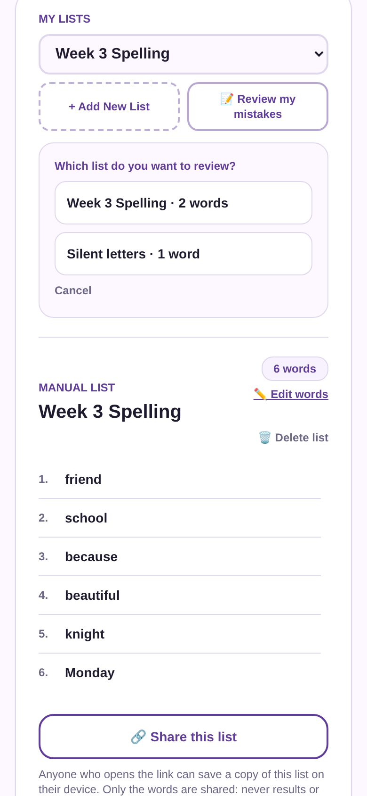
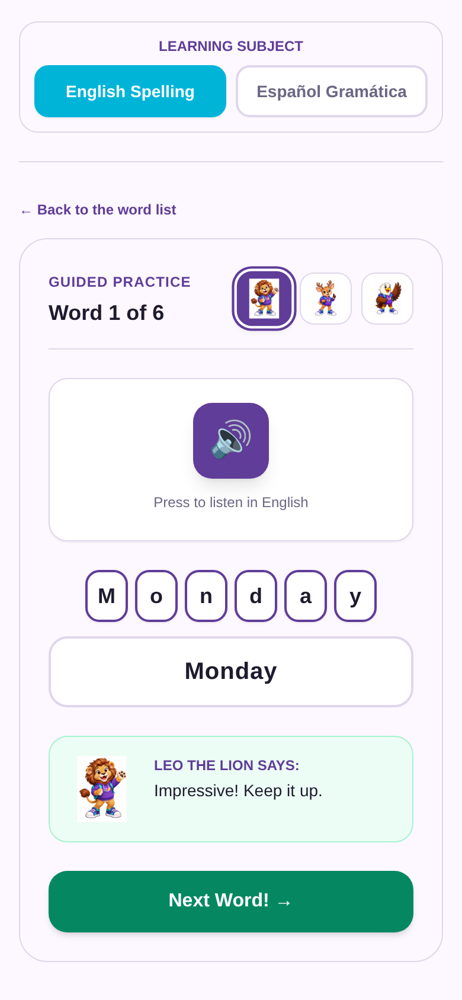
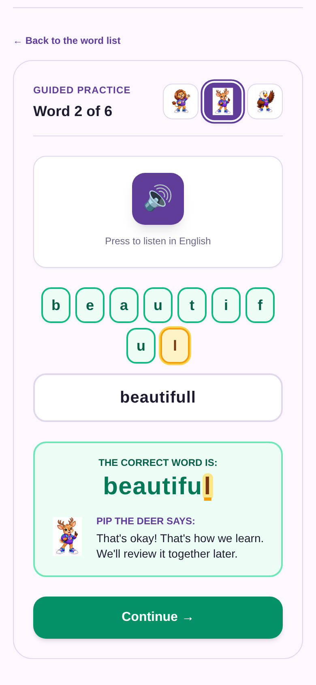
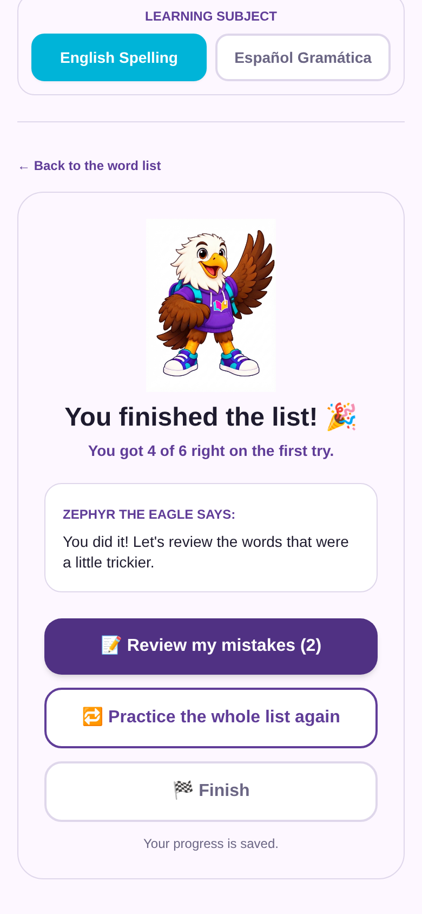
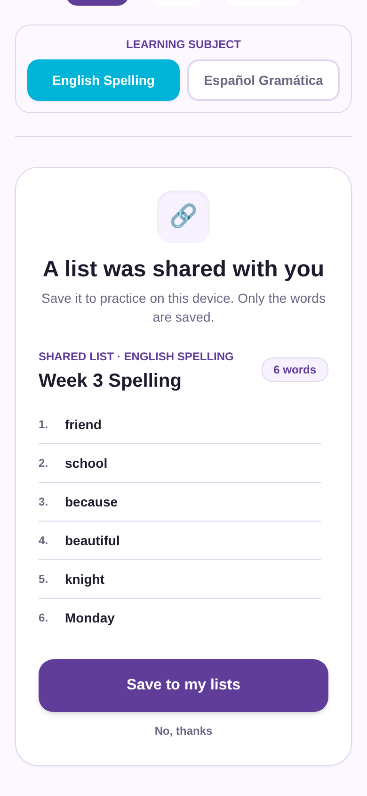
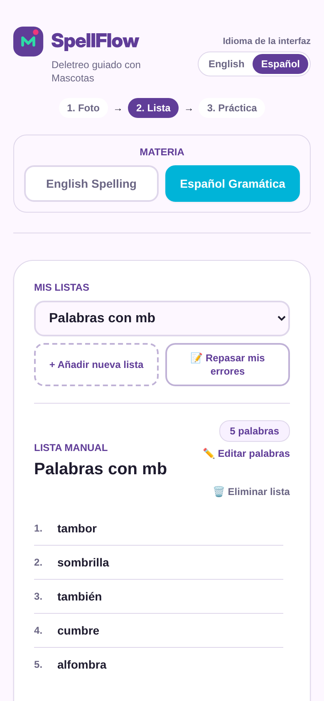

  

<h1 align="center">SpellFlow</h1>

  <b>Free spelling and dictation practice for kids, with friendly mascots.</b> 
  English Spelling · Español Gramática

  👉 <a href="https://spellflow.netlify.app"><b>Try it: spellflow.netlify.app</b></a>

---

## The idea

Every week, kids bring home a list of spelling or dictation words. SpellFlow turns that list into guided practice: the child **hears** each word, **types** it, and gets kind, encouraging feedback from a mascot buddy. No accounts, no ads, no cost.

It was designed together with real families and teachers, and every feature comes from their feedback, including from a young tester who asked for the words to come in a surprise order.

## How it works

| 1. Add the week's list | 2. Practice word by word | 3. Learn from mistakes |
|:---:|:---:|:---:|
|  |  |  |
| Take a photo of a printed list, or type it. Each list keeps its own subject: English or Spanish. | The word is read aloud in the right accent. The child types it and the mascot cheers them on. | Two tries per word. Then the correct word appears with **only the missed letters highlighted**. |

| Finish and review | Share a list with families | Fully bilingual |
|:---:|:---:|:---:|
|  |  |  |
| Review just the missed words, practice the whole list again, or finish. Progress is saved automatically. | Teachers can send a list by link (WhatsApp, email). Only the words are shared, never results. | The interface and the learning subject are independent: Spanish or English for both. |

## Features

- 📸 **Photo to list:** reads printed word lists right on the device. The photo is never uploaded.
- ✏️ **Type a list:** with the photo kept on screen to copy from, for handwritten lists.
- 🔊 **Hear the word** in English (US) or Spanish (Mexico).
- 🦁🦌🦅 **Three mascot buddies** with varied, encouraging messages.
- 🔀 **Random order** in every round, so kids learn the words, not the sequence.
- ✌️ **Two tries per word**, then the right spelling with the exact mistakes highlighted (including capitals and accents).
- 📝 **Review my mistakes:** missed words are kept per list until they are spelled right on the first try.
- ⏸️ **Pause and continue** where you left off.
- 🔗 **Share lists by link**, with only the words.
- 💡 **Tips for parents**, like turning off keyboard suggestions so kids really practice.

## Privacy first

- No accounts, no sign-up, no ads.
- Lists and progress stay **only on the device** where they are used.
- Photos are read **on the device** and never leave it.
- Shared links carry only the list's title and words.
- 100% free to use.

## Built with

Next.js · TypeScript · Tailwind CSS · Tesseract.js (on-device text recognition) · Web Speech API · Netlify

---

  <b>Disponible en español.</b> SpellFlow es una herramienta gratuita para practicar ortografía y dictado, en inglés y en español. 
  <a href="https://spellflow.netlify.app">spellflow.netlify.app</a>

